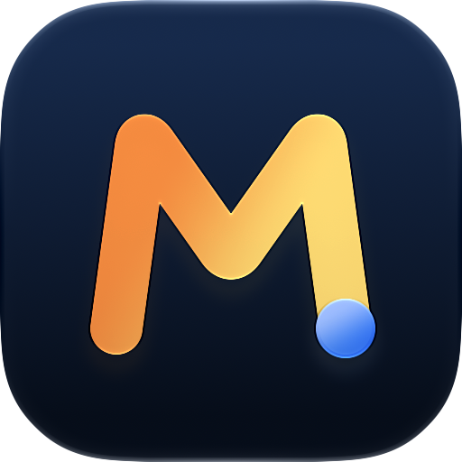
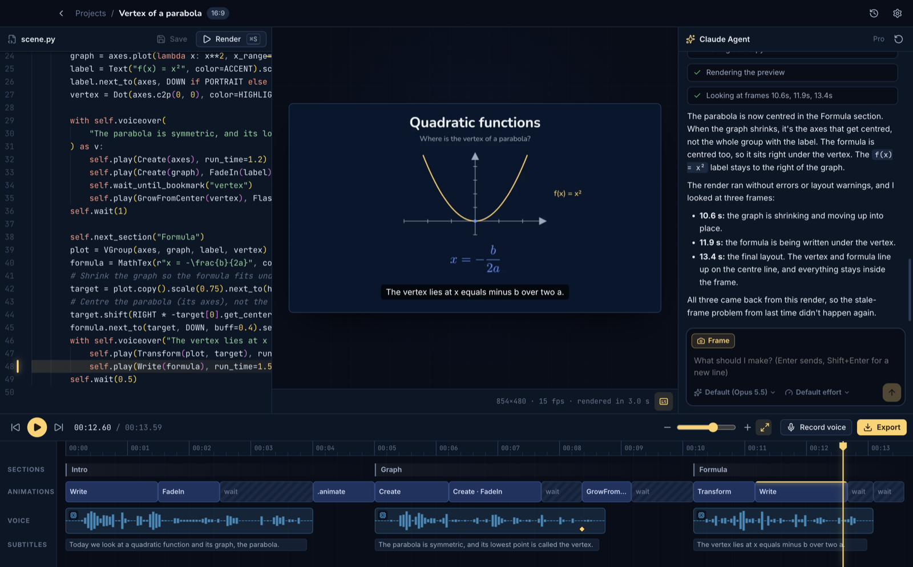
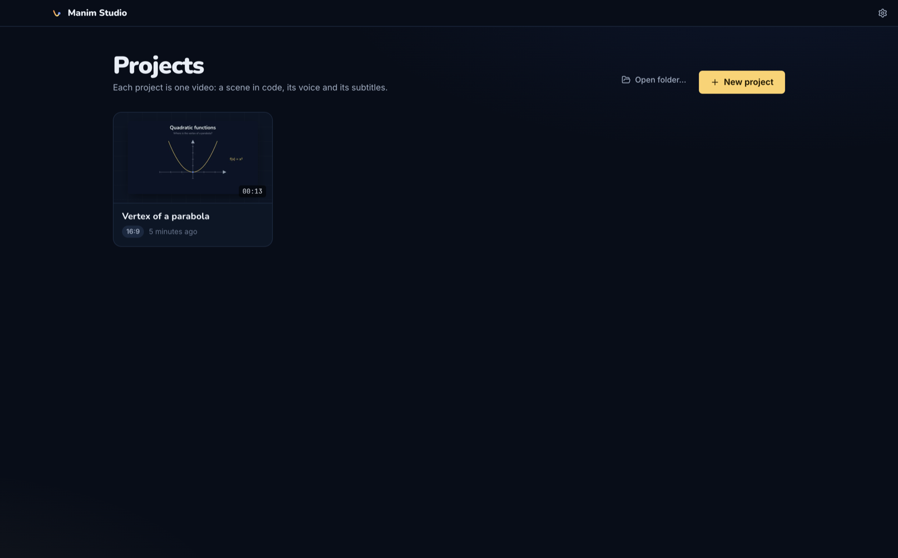
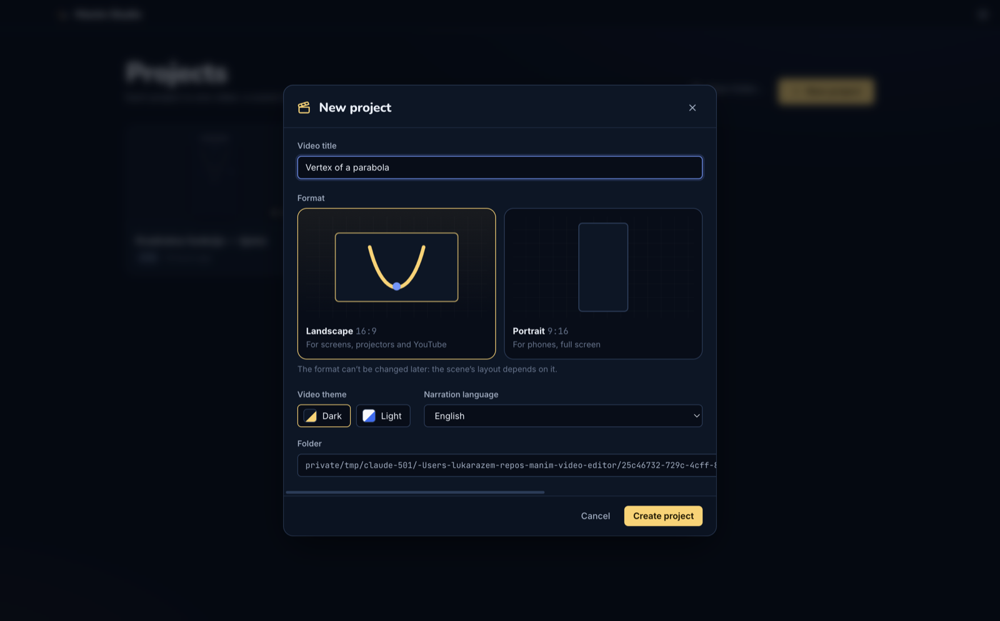
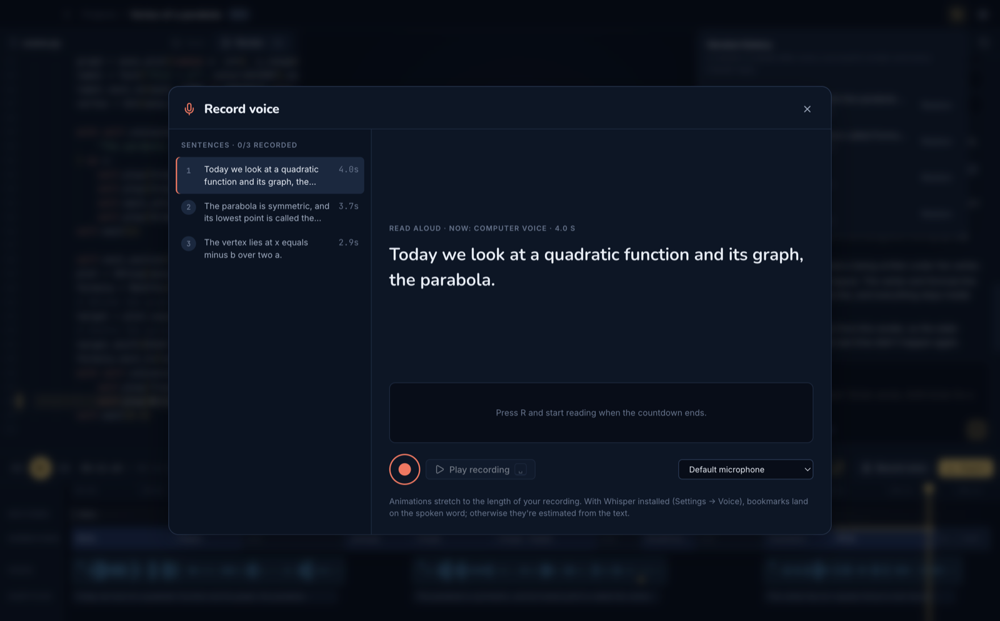
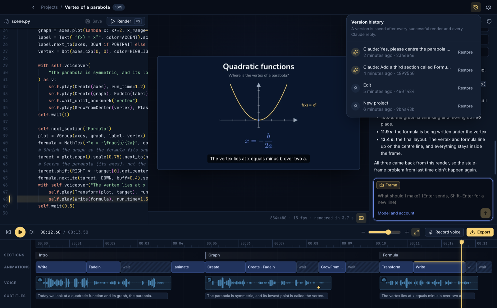
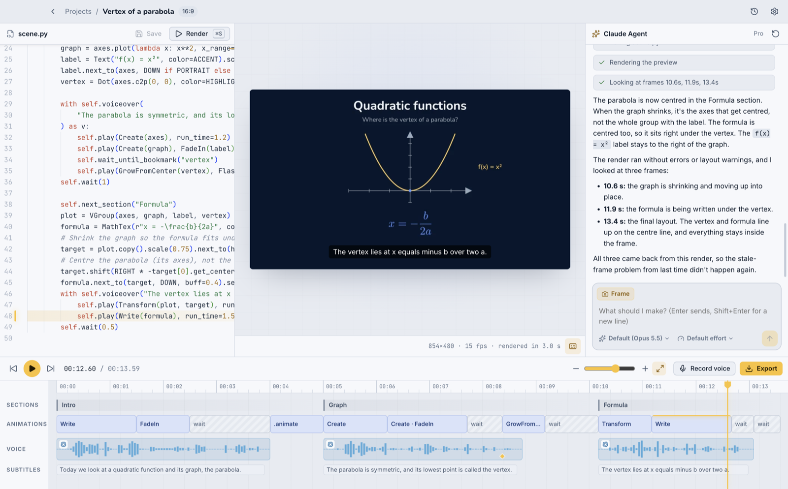
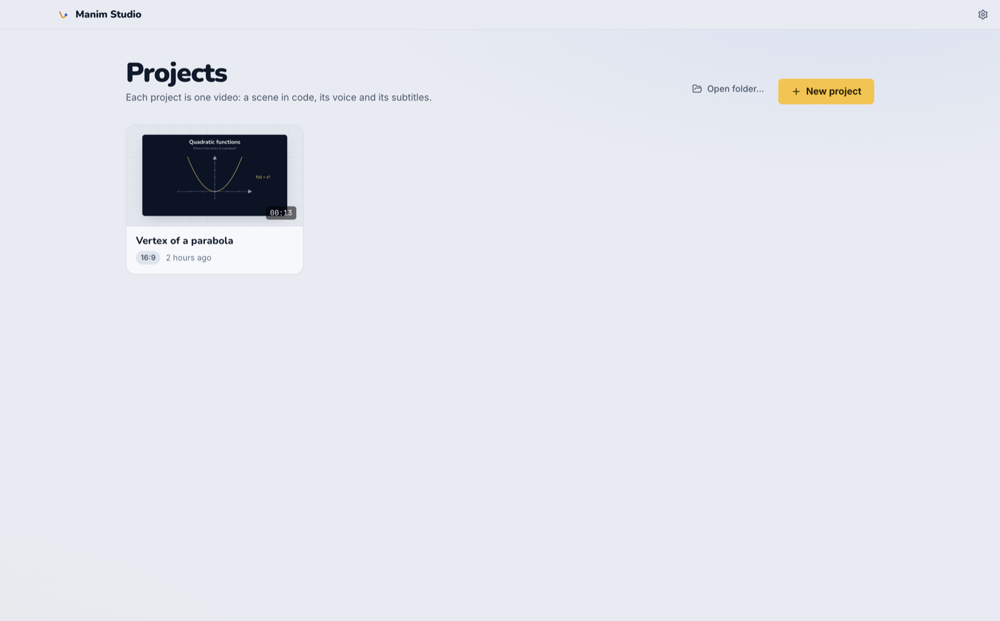

<p align="center"></p>

<h1 align="center">Manim Studio</h1>

<p align="center">A desktop editor for maths explainer videos made with <a href="https://www.manim.community">manim</a>.<br>You describe the video, Claude writes the scene, and you finish it on a real timeline.</p>



## What it does

- **A whole series from a course.** Add a course's lecture PDFs: Claude proposes the episodes and a series bible (notation, visual vocabulary), you edit the plan, and Studio makes the episodes one after another, each referring back to the ones before.
- **Quick video.** Describe it, attach the lecture notes, and Studio makes and exports the video without the editor: Claude writes a script and the scenes, Studio checks the render and sends Claude back to fix what's wrong.
- **Claude writes the scene.** Describe what the video should show. Claude edits `scene.py`, renders it, looks at frames, and fixes layout problems before it answers. It uses your own Claude plan or an Anthropic API key.
- **Or ask Claude Desktop.** Add the Manim Studio extension from Settings, then ask Claude in the Claude desktop app for a maths video. Manim Studio opens and Claude makes it there.
- **The timeline comes from the render.** Sections, every `self.play`, the narration and the subtitles, each linked to its line of code. While the video plays, the line producing the frame lights up.
- **Retime by dragging.** Drag a clip's edge and the `run_time=` in the code changes. Select clips and ask Claude about exactly that part.
- **Narration and subtitles.** Narration lives in the code ([manim-voiceover](https://github.com/ManimCommunity/manim-voiceover)), and subtitles come from it. Voices:
  - [ElevenLabs](https://elevenlabs.io): the most-used voices for your language, or search their whole library, with samples to play
  - local [OmniVoice](https://github.com/k2-fsa/OmniVoice), which can clone your voice
  - your own recordings, made in the recording booth

  Each project has its own voice. Switch it and one click re-voices the narration. Animations stretch to fit the speech.
- **Any language.** Pick the narration language per project. Claude writes in it, and the voices and subtitles follow.
- **16:9 or 9:16.** Choose the format per project, and a light or dark video theme.
- **Light and dark app.** Follows your system by default, and cross-fades when it switches.
- **Version history.** Every render and every Claude turn is a commit you can go back to. No git install needed.
- **Your own pictures and videos.** Drop them into the Media tab, then insert them into the scene or ask Claude to use them.
- **Export for YouTube, in any language.** A 1080p mp4 (light, dark or both), plus subtitles and a dubbed audio track for every language you add. Claude translates, and your chosen voice speaks it over the same video. Exports run in the background, so you can start the next video meanwhile.
- **A short tour** the first time you open a project (Help → Show Tutorial brings it back).

| | |
|---|---|
|  |  |
|  |  |
|  |  |

## Install

Download the installer for your system from the [latest release](https://github.com/lukaznj/manim-studio/releases/latest):

| System | File | First launch |
|---|---|---|
| macOS (Apple Silicon) | `.dmg` | The build isn't notarized yet. Open it once, then **System Settings → Privacy & Security → Open Anyway**. |
| Windows 10/11 (x64) | `-Setup.exe` | SmartScreen may warn about an unknown publisher: **More info → Run anyway**. |
| Linux (x64) | `.AppImage` | `chmod +x` it and run it. |

On first launch the app installs what renders need into its own data folder: Python with manim (about 750 MB) and LaTeX (about 250 MB). You don't need Python, Homebrew or Xcode. After that, it updates itself from GitHub Releases. One exception: unsigned macOS builds can't replace themselves, so the app links to the new release instead.

### Claude

Sign in from the app with your Claude account. The sign-in runs the official Claude Code login in your browser, and Claude Code keeps the credentials, so Manim Studio never sees them. Usage counts against your own plan.

Or switch to an [Anthropic API key](https://console.anthropic.com) in Settings → Claude ("Use Claude with"). It's stored encrypted with your system keychain. With an account, the chat header shows how much of your plan's limits you've used, and Settings → Claude has every limit with its reset time.

## Develop

Needs Node 24. Python, manim and LaTeX come from the app's own installer, as for users.

```bash
npm install
npm run fetch-pixi     # the bundled Python package manager, for this machine
npm run dev
```

```bash
npm run typecheck && npm test   # TypeScript checks and unit tests
npm run test:python             # renders a fixture project end to end
```

The docs in [`docs/`](docs/README.md) are an [Obsidian](https://obsidian.md) vault, and plain markdown otherwise:

- [Product overview](docs/01-product/product-overview.md) and [roadmap](docs/01-product/roadmap.md)
- [Architecture](docs/02-architecture/system-overview.md), the [timeline contract](docs/02-architecture/timeline-from-render.md) and the [voice pipeline](docs/02-architecture/voice-pipeline.md)
- [Decisions](docs/04-decisions/README.md) (ADRs)
- [Development](docs/06-operations/development.md), [releasing](docs/06-operations/releasing.md) and [known issues](docs/06-operations/known-issues.md)

[`CLAUDE.md`](CLAUDE.md) is the short version for coding agents.

## Built on

- [manim](https://www.manim.community) (Community Edition)
- [manim-voiceover](https://github.com/ManimCommunity/manim-voiceover)
- [Claude Agent SDK](https://docs.claude.com/en/docs/agent-sdk/overview)
- [OmniVoice](https://github.com/k2-fsa/OmniVoice)
- [faster-whisper](https://github.com/SYSTRAN/faster-whisper)
- [pixi](https://pixi.sh) and conda-forge
- [TinyTeX](https://yihui.org/tinytex/)
- [Electron](https://www.electronjs.org), [React](https://react.dev), [Monaco](https://microsoft.github.io/monaco-editor/)
- [isomorphic-git](https://isomorphic-git.org)

Manim Studio is an independent project. It isn't affiliated with Anthropic or the Manim Community.

## License

[MIT](LICENSE)
