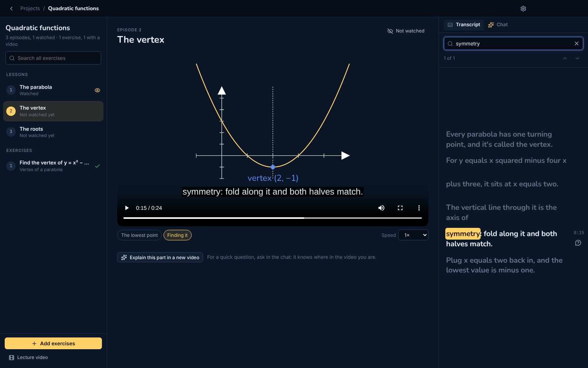
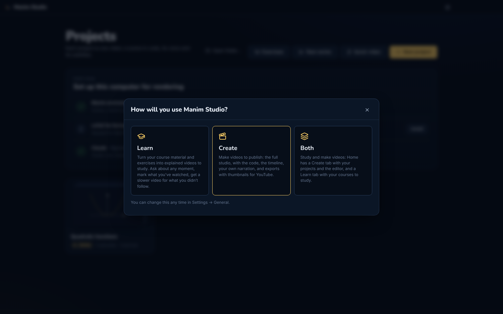
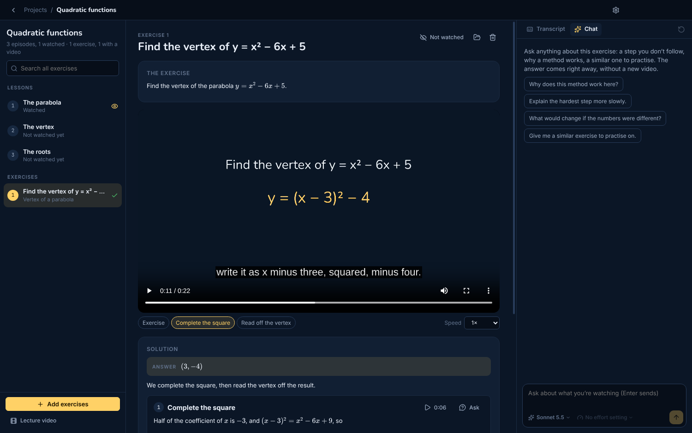
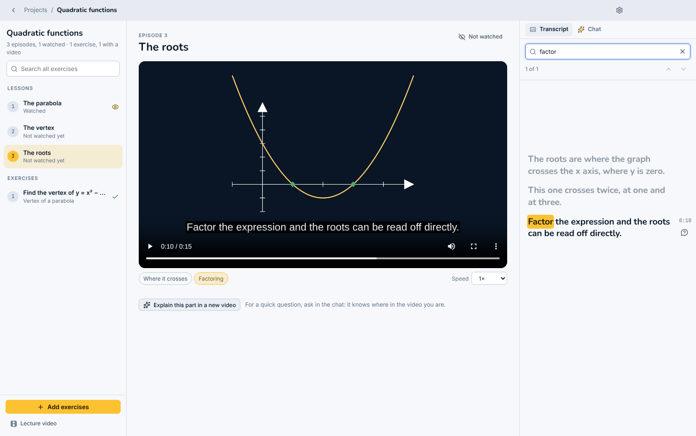

<p align="center"></p>

<h1 align="center">Manim Studio</h1>

<p align="center">A desktop app for maths explainer videos made with <a href="https://www.manim.community">manim</a>.<br>Learn from videos made for your own course, or make videos to publish. An AI agent writes the scenes; Studio renders them.</p>



## Learn, Create, or both

On first launch Manim Studio asks how you'll use it, and you can change it any time in Settings → General.

- **Learn** is for studying. Turn your course material and exercises into explained videos, watch them, and ask about any moment. There's no editor and no code.
- **Create** is the full studio for making videos to publish: the code, a timeline, your own narration, and exports with thumbnails for YouTube.
- **Both** gives Home a Create tab and a Learn tab.



## Learn

- **A course from your PDFs.** Add a course's lecture notes. The agent plans the episodes and a series bible (notation, colours, recurring pictures), and Studio makes every episode in the background, several at once, each building on the ones before.
- **Exercises, solved twice.** Type exercises, paste a screenshot, or add photos and PDFs. Each one is read out, solved in writing step by step (every computation checked with Python), and then turned into a short video whose chapters match the steps. Add exercises to a course and they use the course's notation and point back to the episode that teaches the method.
- **One study screen** per course: its lessons and its exercises in one list, with what you've watched marked.
  - **A player** with chapters, speed, subtitles, and the spot where you left off.
  - **The transcript** follows the video like song lyrics. Search it, and the video jumps to the moment a word is said (Enter for the next match). Click a line to play from there.
  - **A chat that knows where you are.** Questions go with the moment you paused at, the frame on screen and the narration around it, so "I don't get this part" is enough. Answers come right away, with maths typeset.
  - **"Explain this part in a new video"** makes a slower follow-up video for that moment, listed under its episode.
  - **"Explain something better"** on an exercise redoes its video with that step expanded.
  - **Search every exercise** you've ever added, by topic or wording.
  - **A lecture video** joins an exercise set's videos into one, with chapters and subtitles.
- **Quick video.** Describe a topic and attach notes, and Studio makes and exports the video without the editor.



## Create


- **The agent writes the scene.** Describe the video. The agent edits `scene.py`, renders it, looks at frames, and fixes layout problems before it answers. It writes a script first and follows the project's conventions.
- **The timeline comes from the render.** Sections, every `self.play`, the narration and the subtitles, each linked to its line of code. While the video plays, the line producing the frame lights up.
- **Retime by dragging.** Drag a clip's edge and the `run_time=` in the code changes. Select clips and ask about exactly that part.
- **Series and quick videos** work here too: you can make series episodes by hand in the editor, or let Studio make them all.
- **Your own material.** Drop pictures and videos into the Media tab, and add PDFs as sources the agent reads and shows pages from.
- **Ask from Claude Desktop.** Add the Manim Studio extension from Settings, then ask Claude in the Claude desktop app for a maths video. Manim Studio opens and Claude makes it there.
- **Version history.** Every render and every agent turn is a version you can go back to. No git install needed.
- **16:9 or 9:16**, a light or dark video theme, and a tone (professional, warm or playful) per project. New projects keep the bottom of the frame clear for viewers' subtitles.

### Exports

- **For YouTube:** a 1080p or 1440p mp4 at 30 or 60 fps, in the dark theme, the light one or both, with subtitles and a thumbnail card (the scene's key picture, a hook, the episode number and the series name).
- **Complex visuals:** Claude, Codex and Antigravity can use short HTML/SVG/Canvas motion inserts when they materially improve on manim. Three preview frames come first; local rendering is queued, cached and bounded to 12 seconds at 1080p/30 fps. Inserts become ordinary video media inside the manim scene, with narration and subtitles still handled by Studio. This uses the selected agent's normal allowance, not a separate Claude Motion service. See [the motion-insert decision](docs/04-decisions/0061-browser-motion-inserts.md).
- **In other languages:** the agent translates the narration and your voice speaks it over the same video, as an audio track or a dubbed video per language.
- **Faster:** an export is split into parts rendered at once, and the video is encoded on the GPU when there is one (Apple VideoToolbox, NVIDIA NVENC, or AMD on Windows through Media Foundation), with the CPU as the fallback.
- **In the background:** start the next video while exports run. Or send them to a render server on another computer ([manim-studio-renderer](https://github.com/lukaznj/manim-studio-renderer)): pair it with the code it prints and your computer stays free.

### Narration

Narration lives in the code ([manim-voiceover](https://github.com/ManimCommunity/manim-voiceover)), and the subtitles come from it. Each project has its own language and voice. Change the voice and one click re-voices the narration, and the animations stretch to fit the speech.

- [ElevenLabs](https://elevenlabs.io): the most-used voices for your language picked for you, or search their whole library, with samples.
- [OmniVoice](https://github.com/k2-fsa/OmniVoice): local and free, 600+ languages, and it can clone your voice from a short clip.
- Your own recordings, made in the recording booth.

Any narration language works: the agent writes in it, and labels are read as names ("R two three", not "R twenty-three").

| | |
|---|---|
|  |  |
|  |  |

## Agents

Studio works with three agents. Choose one in Settings → Agent; any of them can make series, solve exercises and make follow-up videos, several at once.

| Agent | Sign in with | Or an API key |
|---|---|---|
| **Claude** (Claude Code, through the Agent SDK) | Your Claude account, through Claude Code's own login | [Anthropic](https://console.anthropic.com) |
| **Codex** (OpenAI) | Your ChatGPT account | [OpenAI](https://platform.openai.com) |
| **Antigravity** (Google, Gemini 4 Argon) | Your Google account | [Gemini](https://aistudio.google.com) |

Settings → Accounts holds every sign-in and key in one place, so you can keep several ready and switch. Sign-ins run each agent's own login in your browser: Studio never sees your password or tokens, and usage counts against your own plan. API keys are stored encrypted with your system keychain. Codex and Antigravity are downloaded the first time you choose them, from their official releases, checked against the published hashes. They work only inside the project, with Studio's render and frame tools.

## Install

Download the installer for your system from the [latest release](https://github.com/lukaznj/manim-studio/releases/latest):

| System | File | First launch |
|---|---|---|
| macOS (Apple Silicon) | `.dmg` | The build isn't notarized yet. Open it once, then **System Settings → Privacy & Security → Open Anyway**. |
| Windows 10/11 (x64) | `-Setup.exe` | SmartScreen may warn about an unknown publisher: **More info → Run anyway**. |
| Linux (x64) | `.AppImage` | `chmod +x` it and run it. |

On first launch the app installs what renders need into its own data folder: Python with manim (about 750 MB) and LaTeX (about 250 MB). You don't need Python, Homebrew or Xcode. After that, it updates itself from GitHub Releases. One exception: unsigned macOS builds can't replace themselves, so the app links to the new release instead.

Then sign in to an agent (Settings → Accounts), and for ElevenLabs voices add its key there too.

## Develop

Needs Node 24. Python, manim and LaTeX come from the app's own installer, as for users.

```bash
npm install
npm run fetch-pixi     # the bundled Python package manager, for this machine
npm run dev
```

```bash
npm run typecheck && npm test   # TypeScript checks and unit tests
npm run test:python             # renders a fixture project end to end
npm run build && node scripts/drive.mjs   # drive the built app over HTTP, with screenshots
```

The docs in [`docs/`](docs/README.md) are an [Obsidian](https://obsidian.md) vault, and plain markdown otherwise:

- [Product overview](docs/01-product/product-overview.md) and [roadmap](docs/01-product/roadmap.md)
- [Architecture](docs/02-architecture/system-overview.md), the [timeline contract](docs/02-architecture/timeline-from-render.md), the [voice pipeline](docs/02-architecture/voice-pipeline.md) and [render performance](docs/02-architecture/render-performance.md)
- [Decisions](docs/04-decisions/README.md) (ADRs)
- [Development](docs/06-operations/development.md), [releasing](docs/06-operations/releasing.md) and [known issues](docs/06-operations/known-issues.md)

[`CLAUDE.md`](CLAUDE.md) is the short version for coding agents.

## Built on

- [manim](https://www.manim.community) (Community Edition) and [manim-voiceover](https://github.com/ManimCommunity/manim-voiceover)
- [Claude Agent SDK](https://docs.claude.com/en/docs/agent-sdk/overview), [Codex](https://github.com/openai/codex) and [Antigravity](https://github.com/google-antigravity/antigravity-cli)
- [OmniVoice](https://github.com/k2-fsa/OmniVoice) and [faster-whisper](https://github.com/SYSTRAN/faster-whisper)
- [pixi](https://pixi.sh) and conda-forge, [PyAV](https://pyav.basswood-io.com) and [ffmpeg](https://ffmpeg.org), [TinyTeX](https://yihui.org/tinytex/)
- [Electron](https://www.electronjs.org), [React](https://react.dev), [Monaco](https://microsoft.github.io/monaco-editor/), [KaTeX](https://katex.org)
- [isomorphic-git](https://isomorphic-git.org)

Manim Studio is an independent project. It isn't affiliated with Anthropic, OpenAI, Google or the Manim Community.

## License

[GNU Affero General Public License v3.0 only](LICENSE) (`AGPL-3.0-only`), with the [narrow Claude SDK linking exception](LICENSE-EXCEPTION). Copyright © 2026 Luka Ražem.

When distributing modified versions, provide their corresponding source under AGPLv3. Modified versions offered for interaction over a network must also offer their corresponding source to those users. See [the license](LICENSE) for the full terms.

Previously published versions through v0.13.0 retain their original MIT license. The exception permits combining Studio with the unmodified Claude SDK and its corresponding executable; Studio and modifications to it still carry AGPLv3 source-sharing requirements. Third-party components retain their own licenses.
