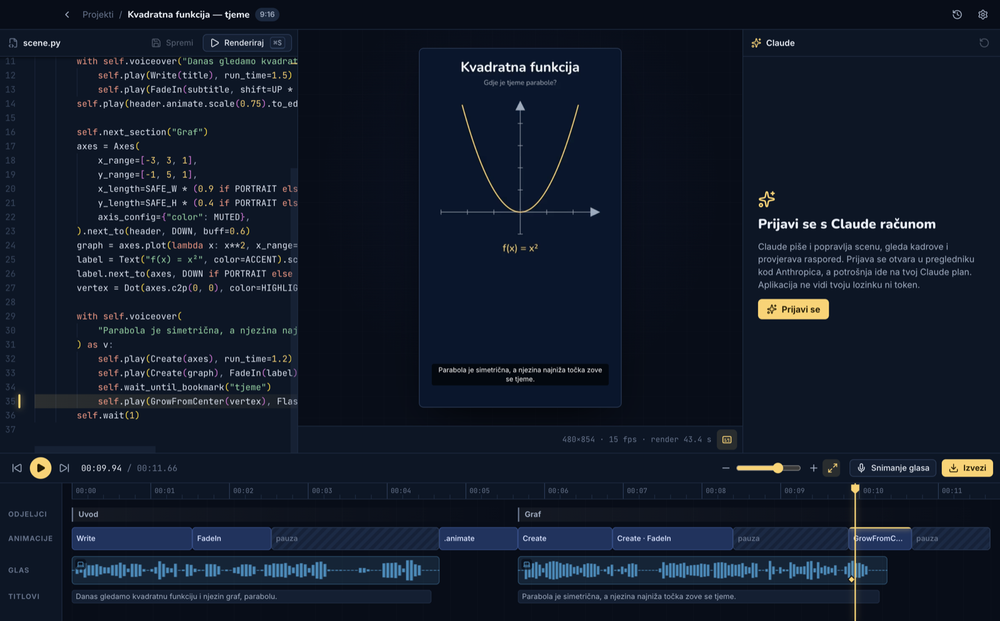

# Manim Studio

A desktop editor for maths explainer videos made with [manim](https://www.manim.community), built for the admins of Maturita.

- **Claude writes the scene.** It uses your own Claude sign-in.
- **The timeline comes from each render.** Every clip links to its line of code, and dragging a clip's edge rewrites its `run_time`.
- **Narration three ways.** A free Croatian voice, ElevenLabs, or local OmniVoice, which can clone your voice. Or record it yourself in the recording booth.
- **Export.** 1080p mp4 in 16:9 or 9:16, `.vtt`/`.srt` subtitles taken from the narration, and a thumbnail.



## Install (admins)

Download the latest installer from the [releases page](https://github.com/lukaznj/manim-studio-releases/releases/latest). On first launch the app installs what it needs (Python + manim, about 750 MB; LaTeX, about 250 MB) and asks you to sign in to Claude. After that it updates itself.

## Develop

```bash
npm install
npm run fetch-pixi     # bundled Python package manager for this machine
npm run dev
```

The rest is in [`docs/`](docs/README.md), an Obsidian vault:

- [architecture](docs/02-architecture/system-overview.md)
- [decisions](docs/04-decisions/README.md)
- [development](docs/06-operations/development.md)
- [releasing](docs/06-operations/releasing.md)
- [known issues](docs/06-operations/known-issues.md)
